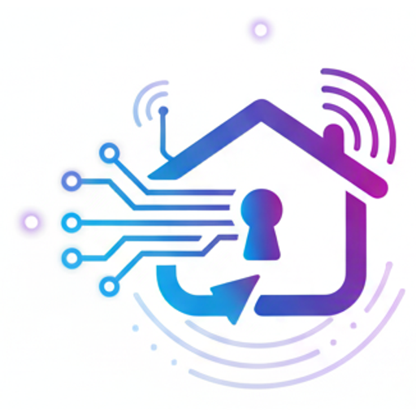

# Servidor MCP de Keyio

**Tus alquileres en España desde tu asistente de IA: partes SES, facturas VeriFactu, cobros e impuestos.**

[Keyio](https://gokeyio.com) es un software de gestión de alquileres para propietarios y gestores en España: vivienda turística, larga estancia, alquiler por habitaciones y compra-venta. Su servidor MCP alojado permite a Claude, ChatGPT, Cursor, VS Code y cualquier otro cliente MCP hacer lo que harías en la app, también el papeleo que exige la ley.

[Read in English](README.md)

| | |
|---|---|
| **URL del servidor** | `https://gokeyio.com/api/mcp` |
| **Transporte** | Streamable HTTP (sin estado) |
| **Autenticación** | OAuth 2.1 con registro dinámico de clientes, o una clave de API (`Authorization: Bearer kk_live_…`) |
| **Nombre en el registro** | `com.gokeyio/keyio` en el [registro oficial de MCP](https://registry.modelcontextprotocol.io) |
| **Herramientas** | Más de 230, marcadas como lectura / escritura / destructiva ([lista](docs/tools.md)) |
| **Precio** | Incluido en todos los planes de Keyio, 30 días de prueba gratis |

Este repositorio reúne la documentación pública, los metadatos del registro y ejemplos de conexión. El servidor lo aloja Keyio: no hay nada que instalar.

## Qué hace

- **Cumplimiento:** añadir los huéspedes de una reserva y, cuando se lo pides, presentar el parte en **SES.HOSPEDAJES**, consultar si se aceptó y anularlo; el fichero del portal de la **Ertzaintza** en el País Vasco; el libro de viajeros; facturas **VeriFactu** (viviendas de sociedad): emitir, enviar, anular y rectificar; la actualización máxima de la renta con el IRAV o el IPC del INE.
- **Día a día:** reservas y contratos, cobros y recordatorios, impagos y renovaciones; gastos con su factura, buzón de facturas y conciliación bancaria; incidencias con fotos y checklists de limpieza; contratos desde tus plantillas y firma electrónica; calendario de precios, presupuestos, calendarios de Airbnb, Booking.com y Vrbo; alquiler por habitaciones; liquidaciones a propietarios; las fichas de tu web propia.
- **Dinero e impuestos:** el resumen del año y el informe fiscal de cada vivienda (IRPF, Impuesto sobre Sociedades o Modelo 210), siempre como estimación para revisar con tu gestor; compra-venta con interesados, venta y liquidación de partícipes.

## Conectar

**Claude:** *Personalizar → Conectores → Añadir conector personalizado*, nombre `Keyio`, URL `https://gokeyio.com/api/mcp`, **Conectar**, inicia sesión en Keyio y elige solo lectura o lectura y escritura.

**Claude Code:** `claude mcp add --transport http keyio https://gokeyio.com/api/mcp` y luego `/mcp`.

**Cursor, VS Code y otros:** ver los [ejemplos](examples/) y el [README en inglés](README.md#connect).

## Qué puedes pedir

- «¿Qué reservas tengo este mes?»
- «Añade los huéspedes de la reserva del viernes y envía el parte a SES.» Luego: «¿Lo ha aceptado SES?»
- «¿Qué alquileres van con retraso?»
- «Apunta 85 € de comunidad en el apartamento de la playa.»
- «Factura la reserva del fin de semana en el Ático y envíasela al huésped.»
- «¿Cuánto puedo subir el alquiler a Ana en su aniversario de noviembre?»
- «¿Cuánto llevo ganado este año, vivienda por vivienda?»

## Seguro por diseño

El asistente actúa con tus permisos y nunca más; eliges lectura o lectura y escritura; los documentos de los huéspedes se ven enmascarados; presentar un parte o emitir una factura solo ocurre cuando lo pides; cada llamada queda registrada en *Ajustes → Desarrolladores*, desde donde puedes desconectarlo. Keyio es de Tripticode SL (España) y trata los datos conforme al RGPD: [política de privacidad](https://gokeyio.com/privacy).

## Enlaces

- Asistente de IA: <https://gokeyio.com/features/ai-assistant>
- Desarrolladores y API: <https://gokeyio.com/developers>
- Precios: <https://gokeyio.com/precios>
- Contacto: info@gokeyio.com
