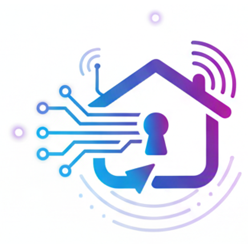

<p align="center"></p>

# Keyio MCP server

**Run your rentals in Spain from your AI assistant: SES filings, VeriFactu invoices, rent, taxes.**

[Keyio](https://gokeyio.com) is property management software for landlords and managers in Spain: holiday lets, long-term rentals, room-by-room lets and buy-to-sell. Its hosted MCP server lets Claude, ChatGPT, Cursor, VS Code and any other MCP client do the work you would otherwise do in the app, including the paperwork Spanish law requires.

[Leer en español](README.es.md)

| | |
|---|---|
| **Server URL** | `https://gokeyio.com/api/mcp` |
| **Transport** | Streamable HTTP (stateless) |
| **Authentication** | OAuth 2.1 with dynamic client registration, or an API key (`Authorization: Bearer kk_live_…`) |
| **Registry name** | `com.gokeyio/keyio` on the [official MCP Registry](https://registry.modelcontextprotocol.io) |
| **Tools** | 230+, annotated read / write / destructive ([full list](docs/tools.md)) |
| **Languages** | English and Spanish |
| **Price** | Included in every Keyio plan, 30-day free trial |

This repository holds the public documentation, the registry metadata and connection examples. The server itself is hosted by Keyio: there is nothing to install or run.

## What it does

**Compliance**
- Add the guests of a booking and, when you ask, file the guest registration (*parte de viajeros*) with **SES.HOSPEDAJES**, check whether it was accepted and cancel it.
- In the Basque Country, get the **Ertzaintza** portal file and the bookings still to report.
- Download the traveller register (*libro de viajeros*) per booking or per property.
- Issue, email, cancel and correct **VeriFactu** invoices for company-owned properties.
- Work out the legal maximum rent update with the INE's IRAV or IPC.

**Day to day**
- Bookings and leases, rent payments and reminders, late-payment escalation and renewals.
- Expenses with the invoice attached, the invoice inbox and mailbox, bank statement reconciliation.
- Maintenance requests with photos, cleaning checklists sent to your team.
- Contracts written from your templates and sent for e-signature.
- Pricing calendar, quotes, Airbnb / Booking.com / Vrbo calendar feeds, room-by-room lets.
- Owner statements and fee invoices for managed homes.
- Your own website's listings and the requests it receives.

**Money and tax**
- The year's income, a property's tax report (IRPF, corporate tax or Modelo 210) and owner statements, always as estimates to check with your tax adviser.
- Buy-to-sell: buyers and offers, the sale, and the settlement of the investors.

## Connect

### Claude (claude.ai, Desktop, mobile)

1. **Customize → Connectors → Add custom connector**.
2. Name `Keyio`, URL `https://gokeyio.com/api/mcp`. Click **Add**.
3. Click **Connect**, sign in to Keyio and choose **read only** or **read and write**.

On Team and Enterprise plans an owner adds the connector once in *Organization settings → Connectors*, then each person connects with their own Keyio account.

### Claude Code

```bash
claude mcp add --transport http keyio https://gokeyio.com/api/mcp
```

Then run `/mcp` to sign in.

### Cursor

`~/.cursor/mcp.json` ([example](examples/cursor-mcp.json)):

```json
{ "mcpServers": { "keyio": { "url": "https://gokeyio.com/api/mcp" } } }
```

### VS Code (GitHub Copilot)

`.vscode/mcp.json` ([example](examples/vscode-mcp.json)):

```json
{ "servers": { "keyio": { "type": "http", "url": "https://gokeyio.com/api/mcp" } } }
```

### ChatGPT

With developer mode on (paid plans): *Settings → Apps & Connectors* → create a connector with the URL above and OAuth authentication.

### Any other client, or with an API key

Any client that follows the [MCP authorization spec](https://modelcontextprotocol.io/specification/2025-06-18/basic/authorization) signs in the same way. A client that sends custom headers can use an API key from **Keyio → Settings → Developer** instead; choose a read-only key unless it should make changes. See [examples/api-key.sh](examples/api-key.sh) for a raw `initialize` + `tools/list` call.

## What you can ask

- "What bookings do I have this month?"
- "Add the guests of Friday's booking, then send the registration to SES." Then: "Did SES accept it?"
- "Which rents are late?"
- "Add this €120 water bill to Calle Mayor 3, dated today."
- "Invoice last weekend's booking at the Ático and email it to the guest."
- "How much can I raise Ana's rent on her November anniversary?"
- "Open a maintenance request at the Sevilla flat: the boiler is leaking, high urgency."
- "How much did my rentals earn in 2025, property by property?"
- "What do we have free in Marbella from 3 to 7 August, and how much?"

In clients that support [MCP Apps](https://modelcontextprotocol.io/docs/extensions/apps), some answers (properties, rentals, expenses, availability, maintenance, checklists, owner statements) appear as screens inside the chat, with forms to create bookings, expenses and requests.

## Safe by design

- **Your permissions, never more.** The assistant sees what you see when you sign in to Keyio. A collaborator who can only view a property cannot change it through an assistant either.
- **Read only or read and write**, chosen when you connect; a read-only connection is not even offered the write tools.
- **Personal data stays masked.** Guests' document numbers show only their last characters; owners' bank and ID numbers are shown only to the owner or an editor. SES credentials can never be set through a chat.
- **Real-world actions only when you ask.** Filing with SES and issuing an invoice are marked destructive; assistants confirm before running them, and Keyio drafts invoices before issuing them.
- **Every call is logged** in *Settings → Developer*, where you can also disconnect any assistant.
- **Limits:** 60 requests a minute and 2,000 a day per connection.

Keyio is made by Tripticode SL in Spain and processes data under the GDPR. See the [privacy policy](https://gokeyio.com/privacy) and [terms](https://gokeyio.com/terms).

## Links

- Product page: <https://gokeyio.com/features/ai-assistant>
- Developer docs and REST API: <https://gokeyio.com/developers>
- Pricing: <https://gokeyio.com/precios>
- Registry metadata: [server.json](server.json)
- Security reports: see [SECURITY.md](SECURITY.md)
- Contact: info@gokeyio.com

## License

The documentation and examples in this repository are under the [MIT License](LICENSE). The Keyio service is proprietary and used under its [terms](https://gokeyio.com/terms).
